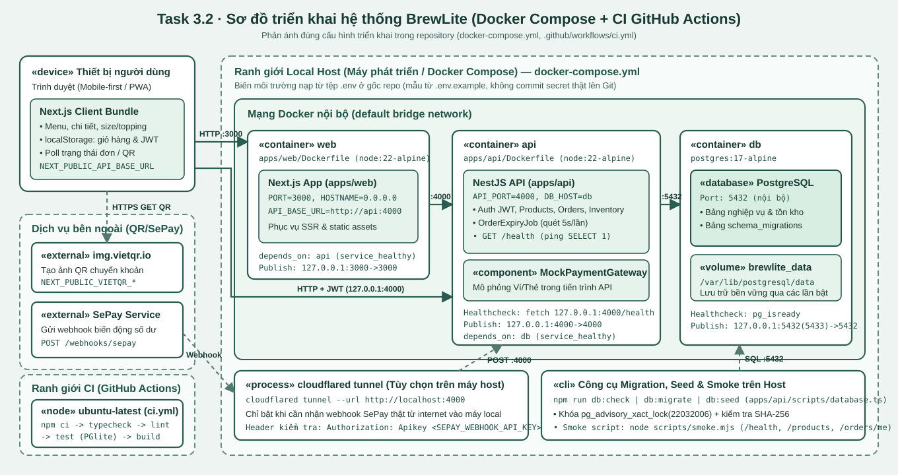

# Task 3 - Thiết kế kiến trúc và sơ đồ triển khai

> Tài liệu này đối chiếu kiến trúc thiết kế của BrewLite với mã nguồn và cấu hình **đang có thực tế trong repository** (`apps/web`, `apps/api`, `docker-compose.yml`, `.github/workflows/ci.yml`). Những hạng mục thuộc mục tiêu triển khai production nhưng chưa có trên repo được ghi rõ trạng thái để đảm bảo tính trung thực khi truy vết.

---

## 1. Task 3.1 - Phương pháp và quyết định kiến trúc

### 1.1 Kiến trúc tổng thể (Phân lớp & Container mức C4)

BrewLite được tổ chức theo mô hình **monorepo hai ứng dụng** (`apps/web` và `apps/api`) kết hợp cơ sở dữ liệu **PostgreSQL** (`db`):

1. **Frontend (`apps/web` - Next.js 15 App Router, hướng mobile-first/PWA):**
   - `src/app/`: Định tuyến trang khách hàng (`/`, `/products/[id]`, `/cart`, `/checkout`, `/payment`, `/payment-status`, `/orders`, `/orders/[id]`) và xác thực (`/login`, `/register`, `/forgot-password`, `/reset-password`).
   - `src/views/` & `src/components/`: Tách giao diện màn hình và các thành phần hiển thị (menu, chọn size/topping, ô nhập mã khuyến mãi, trạng thái loading/empty/error).
   - `src/features/`: Quản lý trạng thái phía trình duyệt bằng `localStorage` cho giỏ hàng (`cart.store.ts` - tự gộp dòng trùng sản phẩm/size/tập topping) và phiên đăng nhập JWT (`auth`).
   - `src/lib/`: Lớp gọi API (`client-api.ts`) tự động đính kèm `Authorization: Bearer <token>`.

2. **Backend (`apps/api` - NestJS phân lớp Controller → Service → Model):**
   - Tất cả provider được đăng ký tại `src/app.module.ts`.
   - **Tầng Controller (`src/controllers/`, `src/sepay/`):** Nhận HTTP request, kiểm tra định dạng đầu vào, xác thực JWT/Apikey và trả mã HTTP chuẩn (`200/201`, `400`, `401`, `403`, `404`, `409`, `503`).
   - **Tầng Service (`src/services/`):** Chứa toàn bộ quy tắc nghiệp vụ: tính lại giá đơn hàng từ DB, kiểm tra khuyến mãi, điều phối transaction giữ/hoàn tồn kho, xử lý idempotency thanh toán, cộng điểm thưởng đúng một lần và quét hết hạn đơn định kỳ (`OrderExpiryJob` mỗi 5 giây).
   - **Tầng Model (`src/models/`):** Thực thi truy vấn SQL tham số hóa qua `DatabaseService` (`pg.Pool`), hỗ trợ truyền `PoolClient` để gom nhiều thao tác vào chung một transaction `BEGIN ... COMMIT/ROLLBACK`.

| Phân hệ / Module | Trách nhiệm chính | Endpoint / Thành phần trong code | Trạng thái hiện tại |
| --- | --- | --- | --- |
| **Products** | Danh mục món, chi tiết, size/topping, lọc món đang bán | `GET /products`, `GET /products/:id` (`ProductsController`, `ProductsService`, `ProductModel`) | Đã hiện thực |
| **Promotions** | Kiểm tra mã giảm giá (`PERCENT`/`FIXED`, hạn dùng, đơn tối thiểu, trần giảm) | Nội bộ khi xem trước/tạo đơn (`PromotionsService`, `PromotionModel`) | Đã hiện thực |
| **Auth & Users** | Đăng ký, đăng nhập, băm mật khẩu bcrypt, cấp/kiểm tra JWT, quên mật khẩu | `POST /auth/register`, `POST /auth/login`, `POST /auth/forgot-password`, `POST /auth/reset-password` | Đã hiện thực |
| **Orders** | Xem trước giá (`previewOrder`), tạo đơn `PENDING`, hủy đơn, cấp lại QR 1 lần, tự hủy đơn quá hạn | `POST /orders/preview`, `POST /orders`, `POST /orders/:id/cancel`, `POST /orders/:id/reissue-qr`, `GET /orders/me`, `GET /orders/:id` | Đã hiện thực |
| **Inventory** | Giữ và hoàn tồn nguyên liệu theo công thức (`ingredients`, `order_ingredient_reservations`) hoặc tồn sản phẩm dự phòng | Nội bộ trong transaction tạo/hủy/hết hạn đơn (`InventoryService`, `InventoryModel`) | Đã hiện thực |
| **Payments (Mock Ví/Thẻ)** | Xử lý thanh toán Ví/Thẻ có `Idempotency-Key`, chống thanh toán trùng, xử lý `SUCCESS`/`FAILED`/`TIMEOUT` | `POST /payments` (`PaymentsController`, `PaymentsService`, `MockPaymentGateway`, `PaymentModel`) | API đã có; **chưa nối vào UI `PaymentView`** |
| **SePay / VietQR** | Hiển thị mã QR chuyển khoản trên web và nhận webhook biến động số dư | `POST /webhooks/sepay` (`SepayController`, `SepayService`, `SepayModel`) | Đã hiện thực trên cả UI và API |
| **Loyalty** | Cộng điểm thưởng (`EARN`) đúng một lần khi đơn chuyển sang `PAID` | Nội bộ trong transaction chốt thanh toán (`LoyaltyService`, `LoyaltyModel`) | Đã hiện thực |
| **Staff Orders** | Nhân viên xem đơn đã trả tiền và chuyển trạng thái `PAID -> PREPARING -> READY -> COMPLETED` | Quy tắc chuyển trạng thái đã có ở `OrderStateService` và DB constraint | **Chưa có controller/UI nhân viên** |
| **Health** | Kiểm tra tình trạng sống của API và kết nối PostgreSQL | `GET /health` (`HealthController`) | Đã hiện thực |

### 1.2 PostgreSQL và cơ chế Migration / Seed

- **Quản lý schema (`apps/api/database/`):** Gồm các tệp SQL đánh số từ `001_schema.sql` đến `009_qr_reissue.sql` và tệp dữ liệu mẫu `002_seed.sql`.
- **Trình chạy migration (`apps/api/scripts/database.ts`):**
  - Sử dụng khóa tư vấn mức giao dịch `SELECT pg_advisory_xact_lock(22032006)` để đảm bảo an toàn khi nhiều tiến trình gọi cùng lúc.
  - Lưu tên tệp và mã băm **SHA-256** vào bảng `schema_migrations`. Nếu tệp migration đã áp dụng bị chỉnh sửa nội dung, script dừng ngay và báo lỗi để buộc tạo migration mới.
  - Các migration cập nhật danh mục sản phẩm/công thức (`003`–`006`, `008`) tự động kiểm tra sự tồn tại của dữ liệu trong bảng `products`; khi khởi tạo DB trắng cần chạy theo thứ tự: `npm run db:migrate -> npm run db:seed -> npm run db:migrate`.

### 1.3 Dịch vụ thanh toán mô phỏng và tích hợp chuyển khoản

- **Mock Payment Service (`apps/api/src/gateways/mock-payment.gateway.ts`):** Đặt bên trong tiến trình NestJS (không tách container riêng), mô phỏng ba kết quả `SUCCESS`, `FAILED` và `TIMEOUT` cho phương thức `WALLET` hoặc `CARD`.
- **Kiểm soát Idempotency (`PaymentsService`):** Mọi yêu cầu `POST /payments` phải kèm `Idempotency-Key`. Bản ghi `payments` được lưu trạng thái `PROCESSING` trước khi gọi gateway; nếu client gửi lại cùng key và cùng payload thì trả lại kết quả cũ mà không trừ tiền hay cộng điểm lần hai; nếu cùng key nhưng khác payload thì trả `409 Conflict`.
- **VietQR & SePay (`apps/api/src/sepay/`):** Phục vụ luồng quét mã QR hiện có trên giao diện web. Webhook `POST /webhooks/sepay` xác thực bằng khóa `SEPAY_WEBHOOK_API_KEY`, khóa dòng đơn hàng (`FOR UPDATE`), kiểm tra khớp mã `DH...` hiện hành, số tiền và thời hạn trước khi cập nhật `PAID`.

### 1.4 Logging, Health Check và quản lý cấu hình

- **Quản lý cấu hình (`apps/api/src/config/environment.ts`):**
  - Nạp duy nhất tệp `.env` tại gốc repository (ưu tiên biến môi trường của tiến trình/container). Mẫu cấu hình không chứa secret thật được lưu tại `.env.example`.
  - Kiểm tra sớm khi khởi động (`main.ts`): bắt buộc `JWT_SECRET` tối thiểu 32 ký tự, chặn các chuỗi mẫu (`replace_`, hoặc `local_only` khi `NODE_ENV=production`), kiểm tra `ORDER_TTL_MINUTES >= 2 * QR_TTL_MINUTES` (mặc định đơn 15 phút, QR 5 phút).
  - Các biến `NEXT_PUBLIC_*` chỉ dùng cho URL API công khai và thông tin hiển thị VietQR; tuyệt đối không đặt secret vào `NEXT_PUBLIC_*`.
- **Health Check (`GET /health`):**
  - Khi `PRODUCT_DATA_SOURCE=postgres`, endpoint thực thi `SELECT 1` (`DatabaseService.ping()`). Nếu DB sẵn sàng trả `200 { status: "ok", dataSource: "postgres", database: "up" }`; nếu mất kết nối trả `503 Service Unavailable`.
  - Được dùng trực tiếp cho `healthcheck` của container `api` trong `docker-compose.yml` và kịch bản `scripts/smoke.mjs`.
- **Logging:**
  - Khi khởi động hoặc cấu hình sai, `main.ts` chỉ in thông điệp từ `ConfigurationError` (đã lọc bỏ giá trị bí mật), không in chuỗi kết nối DB hay secret ra console/log.
  - Trong Docker Compose, log của `web`, `api`, `db` được xuất ra `stdout/stderr` và thu thập qua Docker logging driver.

### 1.5 Lý do chọn kiến trúc, ưu điểm, hạn chế và trade-off

- **Ưu điểm:**
  - Monorepo + Docker Compose giúp đồng bộ hoàn toàn giữa môi trường phát triển local và kiểm thử tự động trên CI.
  - Sử dụng `pg.Pool` + SQL thuần giúp kiểm soát tường minh phạm vi transaction, khóa dòng chống tranh chấp tồn kho cuối và chạy chung bộ schema SQL trên cả PostgreSQL thật lẫn PGlite (trong unit/integration test).
  - Đặt `MockPaymentGateway` và `OrderExpiryJob` trong cùng tiến trình API giúp giảm độ trễ mạng nội bộ và đơn giản hóa việc triển khai.
- **Hạn chế và đánh đổi (Trade-off):**
  - Không dùng ORM nên phải viết và bảo trì câu lệnh SQL thủ công ở lớp `models/`.
  - `OrderExpiryJob` chạy bằng `setInterval` trong tiến trình API nên phù hợp với mô hình 1 instance API; nếu mở rộng nhiều bản sao API cần thêm khóa phân tán hoặc tách worker riêng.
  - Hiện tại luồng thanh toán trên giao diện web mới nối với VietQR/SePay, còn nhánh Mock Ví/Thẻ mới có ở tầng API/test.

### 1.6 Danh mục Hồ sơ quyết định kiến trúc (ADR)

Các quyết định kiến trúc trọng tâm được ghi chi tiết trong thư mục [`docs/architecture/adr/`](adr/):

1. [ADR 001 - Tổ chức mã nguồn theo npm workspaces monorepo (`apps/web`, `apps/api`)](adr/001-monorepo.md)
2. [ADR 002 - Kiến trúc phân lớp với Next.js, NestJS và SQL thuần qua `pg` Pool + Migration tự quản](adr/002-layered-nestjs-pg-migrations.md)
3. [ADR 003 - Giao dịch tạo đơn, giữ tồn nguyên liệu/sản phẩm và tự động hết hạn](adr/003-transaction-inventory-and-expiry.md)
4. [ADR 004 - Kiến trúc thanh toán kép (Mock Ví/Thẻ có Idempotency và Webhook VietQR/SePay)](adr/004-payment-idempotency-and-sepay.md)
5. [ADR 005 - Triển khai bằng Docker Compose và phân tách cấu hình theo môi trường](adr/005-docker-compose-and-deployment.md)

---

## 2. Task 3.2 - Deployment Diagram

Theo mục 9 của đề bài (`Cấu trúc repository`), tài liệu chi tiết của phần triển khai được đặt ở ngoài tại [`docs/deployment.md`](../deployment.md), còn tệp nguồn và ảnh sơ đồ đặt tại [`docs/diagrams/deployment.puml`](../diagrams/deployment.puml) và [`docs/diagrams/deployment.svg`](../diagrams/deployment.svg).

Xem đầy đủ bảng chi tiết cổng/giao thức, ranh giới Local–CI–Production và bảng truy vết container về mã nguồn tại **[`docs/deployment.md`](../deployment.md)**.

