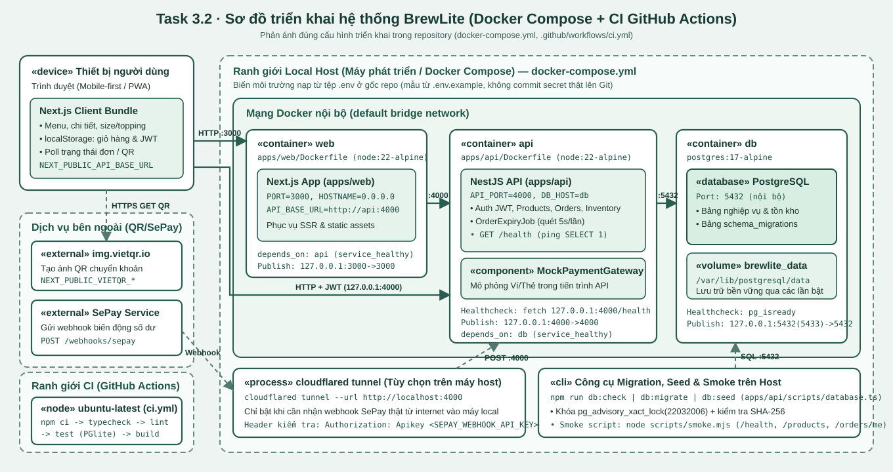

# Task 3.2 - Sơ đồ và kiến trúc triển khai (Deployment)

> Tài liệu này mô tả sơ đồ triển khai (Task 3.2) đối chiếu trực tiếp với cấu hình hiện có trong repository ([docker-compose.yml](../docker-compose.yml), [.github/workflows/ci.yml](../.github/workflows/ci.yml), [.env.example](../.env.example), [scripts/smoke.mjs](../scripts/smoke.mjs)). Mô tả kiến trúc phân lớp và các ADR của Task 3.1 xem tại [docs/architecture/README.md](architecture/README.md).

## 1. Sơ đồ triển khai hiện tại (Deployment Diagram)

- **Nguồn PlantUML:** [docs/diagrams/deployment.puml](diagrams/deployment.puml)
- **Ảnh kết xuất SVG:** [docs/diagrams/deployment.svg](diagrams/deployment.svg)

## 2. Chi tiết các thành phần, giao thức, cổng và ranh giới môi trường

| Ranh giới | Thành phần / Node | Công nghệ / Image | Cổng & Giao thức | Vai trò vận hành |
| --- | --- | --- | --- | --- |
| **Thiết bị người dùng** | Trình duyệt (Mobile-first / PWA) | Next.js Client Bundle | HTTP `127.0.0.1:3000`, `127.0.0.1:4000`; HTTPS tới `img.vietqr.io` | Hiển thị giao diện khách hàng, lưu giỏ hàng và JWT tại `localStorage`, gọi API kèm `Authorization: Bearer <JWT>`. |
| **Local Host (Docker Compose)** | Container `web` | `node:22-alpine` ([apps/web/Dockerfile](../apps/web/Dockerfile)) | Host `127.0.0.1:3000 -> 3000`; gọi nội bộ `http://api:4000` | Phục vụ giao diện Next.js (`npm run start -w apps/web`), chờ `api` đạt `service_healthy` mới khởi động. |
| **Local Host (Docker Compose)** | Container `api` | `node:22-alpine` ([apps/api/Dockerfile](../apps/api/Dockerfile)) | Host `127.0.0.1:4000 -> 4000`; kết nối nội bộ `db:5432` | Chạy NestJS API, `MockPaymentGateway` (in-process Ví/Thẻ) và `OrderExpiryJob` (5s/lần). Healthcheck gọi `http://127.0.0.1:4000/health`. |
| **Local Host (Docker Compose)** | Container `db` + Volume `brewlite_data` | `postgres:17-alpine` | Nội bộ `5432`; Host `127.0.0.1:5432` (hoặc `5433` nếu trùng cổng PG trên máy) | Lưu trữ dữ liệu bền vững tại `/var/lib/postgresql/data`; healthcheck bằng `pg_isready -U $POSTGRES_USER -d $POSTGRES_DB`. |
| **Local Host (Ngoài container)** | `cloudflared tunnel` & Script CLI | `cloudflared`, Node CLI ([apps/api/scripts/database.ts](../apps/api/scripts/database.ts), [scripts/smoke.mjs](../scripts/smoke.mjs)) | HTTPS `*.trycloudflare.com -> http://localhost:4000` | Bật tạm thời khi thử nhận webhook `POST /webhooks/sepay` từ internet vào máy local; chạy `db:check`, `db:migrate`, `db:seed` và smoke test. |
| **CI (GitHub Actions)** | Runner `ubuntu-latest` | Node.js 22 ([.github/workflows/ci.yml](../.github/workflows/ci.yml)) | HTTPS (GitHub) | Chạy job `check` trên mọi Pull Request và push vào `main`: `npm ci -> typecheck -> lint -> test (PGlite) -> build`. |
| **Dịch vụ bên ngoài** | `img.vietqr.io` & `SePay` | Dịch vụ HTTP/HTTPS bên ngoài | HTTPS `443` | Tạo ảnh mã VietQR theo `NEXT_PUBLIC_VIETQR_*` và gửi webhook xác nhận chuyển khoản kèm header `Authorization: Apikey <SEPAY_WEBHOOK_API_KEY>`. |

## 3. Quản lý Secret, Biến môi trường, Health Check và Log

- **Secrets & Environment Variables ([.env.example](../.env.example), [environment.ts](../apps/api/src/config/environment.ts)):**
  - Tệp `.env` đặt tại gốc repo và bị chặn bởi `.gitignore`; repository chỉ lưu `.env.example` với giá trị mẫu.
  - Các biến nhạy cảm chỉ nạp ở phía server/API: `DB_PASSWORD`, `JWT_SECRET` (bắt buộc `>= 32` ký tự, từ chối chuỗi mẫu `replace_` hoặc `local_only` khi `NODE_ENV=production`), `SEPAY_WEBHOOK_API_KEY`.
  - Các biến `NEXT_PUBLIC_*` (`NEXT_PUBLIC_API_BASE_URL`, `NEXT_PUBLIC_VIETQR_*`) được nhúng vào bundle trình duyệt lúc build nên tuyệt đối không chứa secret.
- **Health Check ([health.controller.ts](../apps/api/src/controllers/system/health.controller.ts)):**
  - `GET /health` gọi `DatabaseService.ping()` (`SELECT 1`). Trả `200 { status: "ok", dataSource: "postgres", database: "up" }` khi DB hoạt động và `503 Service Unavailable` khi mất kết nối DB.
- **Logging:**
  - Khi cấu hình sai lúc khởi động, `main.ts` chỉ in thông báo từ `ConfigurationError` (không lộ secret hoặc chuỗi kết nối). Log container xuất ra `stdout/stderr` và xem qua `docker compose logs`.

## 4. Truy vết từ Deployment Diagram về Mô tả kiến trúc và Mã nguồn

| Thành phần trong sơ đồ | Thành phần kiến trúc ([docs/architecture/README.md](architecture/README.md)) | Đường dẫn mã nguồn / cấu hình |
| --- | --- | --- |
| `«device» Thiết bị người dùng` & `«container» web` | Frontend Next.js (App Router, CartStore, Auth) | [apps/web/](../apps/web/), [apps/web/Dockerfile](../apps/web/Dockerfile), [apps/web/next.config.ts](../apps/web/next.config.ts), [apps/web/src/lib/client-api.ts](../apps/web/src/lib/client-api.ts) |
| `«container» api` | Backend NestJS theo module/domain | [apps/api/](../apps/api/), [apps/api/Dockerfile](../apps/api/Dockerfile), [apps/api/src/main.ts](../apps/api/src/main.ts), [apps/api/src/app.module.ts](../apps/api/src/app.module.ts) |
| `GET /health` & Container Healthcheck | Kiểm tra sức khỏe API và DB | [apps/api/src/controllers/system/health.controller.ts](../apps/api/src/controllers/system/health.controller.ts), [docker-compose.yml](../docker-compose.yml), [scripts/smoke.mjs](../scripts/smoke.mjs) |
| `«component» MockPaymentGateway` | Dịch vụ thanh toán Ví/Thẻ mô phỏng (in-process) | [apps/api/src/gateways/mock-payment.gateway.ts](../apps/api/src/gateways/mock-payment.gateway.ts), [apps/api/src/services/payments.service.ts](../apps/api/src/services/payments.service.ts) |
| `«external» SePay` & `img.vietqr.io` | Thanh toán chuyển khoản QR | [apps/api/src/sepay/](../apps/api/src/sepay/), [apps/web/src/views/customer/payment/PaymentView.tsx](../apps/web/src/views/customer/payment/PaymentView.tsx) |
| `«container» db` & `«volume» brewlite_data` | PostgreSQL có persistent storage | [docker-compose.yml](../docker-compose.yml), [apps/api/src/config/db.ts](../apps/api/src/config/db.ts) |
| `«cli» Công cụ Migration & Seed` | Cơ chế migration có khóa tư vấn & SHA-256 | [apps/api/scripts/database.ts](../apps/api/scripts/database.ts), [apps/api/database/](../apps/api/database/) |
| Quản lý Secret & Biến môi trường | Nạp và kiểm tra cấu hình an toàn | [.env.example](../.env.example), [apps/api/src/config/environment.ts](../apps/api/src/config/environment.ts) |
| `Ranh giới CI (GitHub Actions)` | Continuous Integration Quality Gate | [.github/workflows/ci.yml](../.github/workflows/ci.yml), [package.json](../package.json) |
