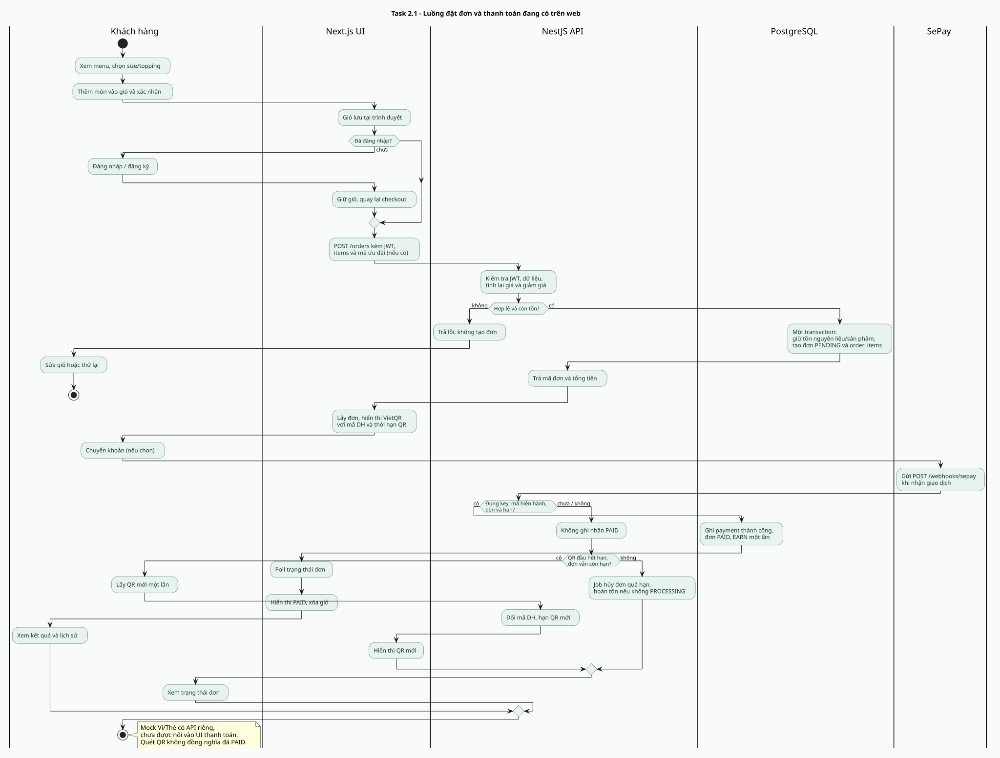
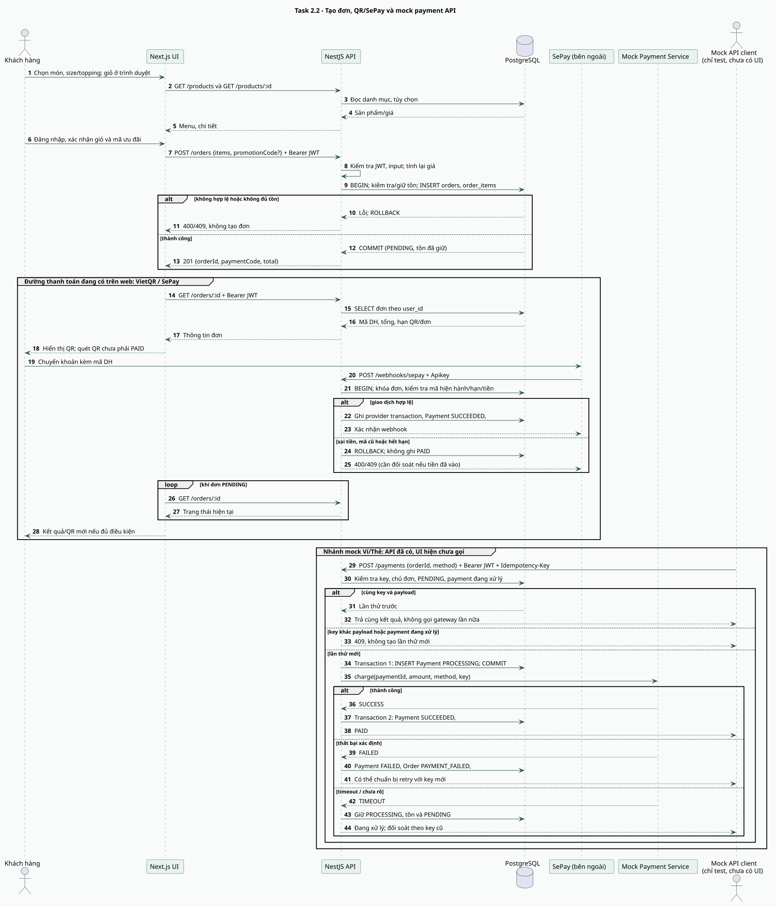
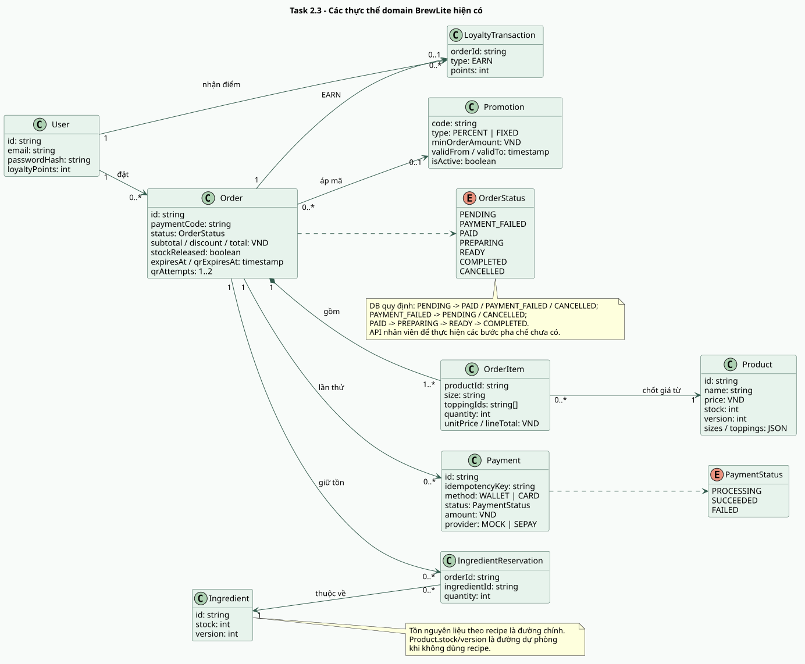

# Task 2 - Sơ đồ đối chiếu với code hiện tại

Các hình dưới đây thay cho bảy hình Task 2 trong `docs/File_Bao_Cao_Tong_Hop.docx`: chỉ giữ một activity, một sequence tổng hợp và một class diagram. Mỗi hình có file PlantUML `.puml` có thể sửa và ảnh `.svg` để xem/chèn vào báo cáo.

## Activity: Đặt đơn và thanh toán đang có trên web

Nguồn: [activity-checkout.puml](activity-checkout.puml). Ảnh: [activity-checkout.svg](activity-checkout.svg).

## Sequence: Tạo đơn và hai đường thanh toán

Nguồn: [sequence-checkout.puml](sequence-checkout.puml). Ảnh: [sequence-checkout.svg](sequence-checkout.svg).

Nhánh QR/SePay là đường từ UI hiện tại. Mock Ví/Thẻ có API và gateway mô phỏng nhưng **chưa được nối vào màn hình thanh toán**; diễn viên "Mock API client" chỉ dùng để phân biệt nhánh đó, không phải giao diện khách đã hoàn thành.

## Class: Thực thể nghiệp vụ và tồn kho

Nguồn: [class-domain.puml](class-domain.puml). Ảnh: [class-domain.svg](class-domain.svg).

Sơ đồ lớp là mô hình domain từ bảng dữ liệu, không khẳng định dự án đang dùng ORM. Quy tắc trạng thái đã có ở backend/DB; **API và vai trò nhân viên để cập nhật pha chế chưa có**. Khi nhóm thêm mock UI hoặc API nhân viên, cập nhật lại cả `.puml`, `.svg` và báo cáo Word.
