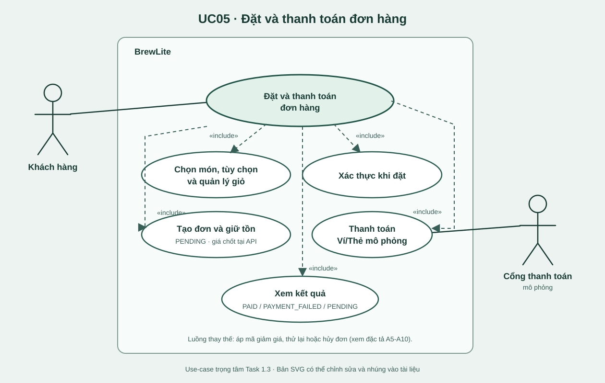

# Task 1.3 - UC05: Đặt và thanh toán đơn hàng

> Rút gọn từ `docs/File_Bao_Cao_Tong_Hop.docx`. Liên kết yêu cầu xem [SRS](srs.md); các kịch bản và test dưới đây là đặc tả/dự kiến, không chứng minh hệ thống đã thực hiện.

## Phạm vi và điều kiện

- **Tác nhân chính:** khách hàng; **hỗ trợ:** cổng thanh toán Ví/Thẻ mô phỏng.
- **Kích hoạt:** khách mở menu để chọn đồ uống.
- **Tiền điều kiện:** truy cập được ứng dụng; chưa cần đăng nhập hoặc có sẵn giỏ. Xác thực bắt buộc khi đặt và thanh toán.
- **Trong phạm vi:** menu, tùy chọn, giỏ, tạo đơn, thanh toán, thử lại/hủy và nhận kết quả.
- **Ngoài phạm vi use-case:** chi tiết đăng ký/đăng nhập, pha chế/bàn giao, hoàn tiền tự động, cổng thanh toán tiền thật.

| Kết quả | Hậu điều kiện |
| --- | --- |
| Thành công | Đơn `PAID`, đúng một thanh toán thành công và một `EARN`, tồn đã giữ/trừ, giỏ xóa, khách thấy mã/trạng thái. |
| Chưa tạo đơn | Giỏ/giá/mã/tồn không hợp lệ: không có đơn, tồn nguyên, giỏ giữ. |
| Thanh toán thất bại xác định | `PAYMENT_FAILED`, hoàn tồn, giữ giỏ, không cộng điểm. |
| Hủy hoặc hết hạn | `CANCELLED`, hoàn tồn đúng một lần. |
| Kết quả thanh toán chưa rõ | Đơn `PENDING`, payment `PROCESSING`, giữ tồn/giỏ; không cộng điểm hoặc kết luận thất bại. |

## Sơ đồ use-case trọng tâm

Bản [SVG có thể chỉnh sửa](../diagrams/use-case-checkout.svg) nằm trong `docs/diagrams/`. Các nhánh áp mã, thử lại, hủy và lỗi được đặc tả bằng A5-A10, E1-E12 bên dưới thay vì vẽ chồng lên luồng chính.

## Quy tắc nghiệp vụ chính

| Mã | Quy tắc |
| --- | --- |
| BR-01, BR-02 | Chỉ chọn size/topping được phép; số lượng dòng 1-99; cấu hình món trùng nhau được gộp. |
| BR-03, BR-04 | Backend tính lại giá; giữ tồn và tạo đơn trong cùng transaction, tồn không âm. |
| BR-05 | Mỗi lần thử thanh toán có Idempotency-Key; cùng key/payload trả cùng kết quả, khác payload trả 409. |
| BR-06, BR-07 | Chỉ cộng một `EARN` sau `PAID`; tối đa một mã giảm giá, giảm không vượt tiền hàng. |
| BR-08, BR-09 | Khách chỉ thao tác đơn của mình; không hủy nếu có thanh toán `PROCESSING` hoặc đã thành công. |
| BR-10, BR-11 | Hoàn tồn khi thất bại xác định, hủy hoặc hết hạn; không hoàn khi kết quả chưa rõ; chỉ xóa giỏ sau `PAID`. |
| BR-12, BR-13 | Đơn `PENDING` không sửa món; muốn sửa phải hủy. Đơn chưa thanh toán có hạn giữ tồn và sẽ tự hủy/hoàn tồn khi hết hạn mà không có payment đang xử lý. |

## Luồng chính

| Bước | Khách hàng | Hệ thống |
| --- | --- | --- |
| 1-2 | Mở menu | `GET /products`, hiển thị tên, ảnh, giá. |
| 3 | Chọn món | Hiển thị chi tiết, size, topping được phép. |
| 4-5 | Chọn tùy chọn/số lượng, thêm và xem giỏ | Cập nhật giá/tổng, gộp dòng trùng. |
| 6-7 | Chọn đặt đơn | Kiểm tra giỏ và JWT; chưa đăng nhập theo A1. |
| 8-10 | Xem xác nhận, nhập mã nếu có, đồng ý đặt | API xác thực, kiểm tra sản phẩm/tùy chọn, tính lại giá và kiểm tra ưu đãi. |
| 11 | Chờ tạo đơn | Một transaction giữ tồn, tạo `Order PENDING` và `OrderItem` với giá chốt. |
| 12-13 | Chọn Ví/Thẻ và xác nhận | Sinh key, kiểm tra JWT/quyền/trạng thái và ghi lần thử `PROCESSING`. |
| 14-15 | Chờ kết quả | Gọi mock gateway; nếu thành công thì transaction chốt payment, đơn `PAID`, một `EARN`. |
| 16 | Nhận kết quả | Hiển thị mã và `PAID`, xóa giỏ. |

## Luồng thay thế

| Mã | Điều kiện | Xử lý |
| --- | --- | --- |
| A1 | Chưa đăng nhập ở bước 7 | Đến đăng nhập/đăng ký, giữ giỏ, quay lại xác nhận nếu thành công. |
| A2-A4 | Thêm món, sửa/xóa giỏ hoặc quay lại từ màn xác nhận | Cập nhật giỏ/tổng; giỏ rỗng trở về menu; chưa tạo đơn. |
| A5-A6 | Mã hợp lệ hoặc không hợp lệ | Áp giảm hợp lệ (không vượt tổng); mã sai/hết hạn/chưa đủ mức thì không tạo đơn, cho sửa/bỏ mã. |
| A7 | Đổi Ví/Thẻ trước khi gửi | Cập nhật phương thức, chưa ghi payment. |
| A8 | Thử lại sau `PAYMENT_FAILED` | Kiểm tra/giữ tồn mới, đưa đơn về `PENDING`, dùng key mới; không đủ tồn theo E3/E4. |
| A9 | Hủy đơn chưa thanh toán và không `PROCESSING` | `CANCELLED`, hoàn tồn, giữ giỏ; xung đột theo E12. |
| A10 | Đơn `PENDING` hết hạn, không có thanh toán đang xử lý | Tự hủy và hoàn tồn; kết thúc. |

## Luồng ngoại lệ

| Mã | Tình huống | Kết quả bắt buộc |
| --- | --- | --- |
| E1-E2 | Menu lỗi/rỗng; giỏ rỗng hoặc size/topping/số lượng sai | Hiển thị error/empty hoặc trường sai; không tạo đơn, cho thử lại. |
| E3-E4 | Hết hàng hoặc hai khách tranh phần tồn cuối | Chỉ một bên thành công; bên kia rollback, không có đơn/tồn âm. |
| E5 | JWT thiếu, sai hoặc hết hạn | 401; giữ giỏ/đơn hiện có, đăng nhập lại trước khi tiếp tục. |
| E6 | Lỗi giữa transaction tạo đơn | Rollback cả đơn và giữ tồn, báo thử lại. |
| E7 | Gateway từ chối rõ ràng | `PAYMENT_FAILED`, hoàn tồn, giữ giỏ/điểm; có thể thử lại hoặc hủy. |
| E8 | Timeout/kết quả chưa rõ | Giữ `PENDING` + `PROCESSING` và tồn; khóa hủy/payment mới, đối soát theo key. |
| E9-E10 | Gửi lại cùng key/payload hoặc cùng key/khác payload | Trả kết quả cũ không charge lại; khác payload từ chối 409. |
| E11 | Xem/thanh toán đơn người khác | Chặn, không đổi dữ liệu; mã HTTP 403 hoặc 404 cần nhóm thống nhất. |
| E12 | Hủy/thanh toán/thử lại xung đột trạng thái | 409, chỉ thao tác hợp lệ thắng; hiển thị trạng thái hiện tại. |

## Truy vết và test dự kiến

| Phần của UC05 | Yêu cầu | Test dự kiến |
| --- | --- | --- |
| Menu, tùy chọn, giỏ | FR-01 đến FR-04; NFR-01, NFR-05 | UC05-T01 đến T05 |
| Xác thực/quyền, tính giá server, ưu đãi | FR-04 đến FR-06, FR-13; NFR-02, NFR-03 | UC05-T06 đến T10 |
| Tạo đơn/giữ tồn/rollback | FR-07, FR-08; NFR-04 | UC05-T11 đến T15 |
| Thành công/thất bại/timeout mock payment | FR-09, FR-14, FR-15 | UC05-T16 đến T19 |
| Idempotency/điểm đúng một lần | FR-10, FR-14; NFR-04 | UC05-T20 đến T22 |
| Xác nhận, sở hữu, retry/hủy/hết hạn | FR-11, FR-12, FR-15; NFR-03 | UC05-T23 đến T27 |
| Toàn luồng | NFR-08 | UC05-INT, UC05-E2E |

Các mã test ở bảng trên là **kế hoạch**; khi có test chạy được, ma trận truy vết cần thay bằng đường dẫn và tên test thật.
